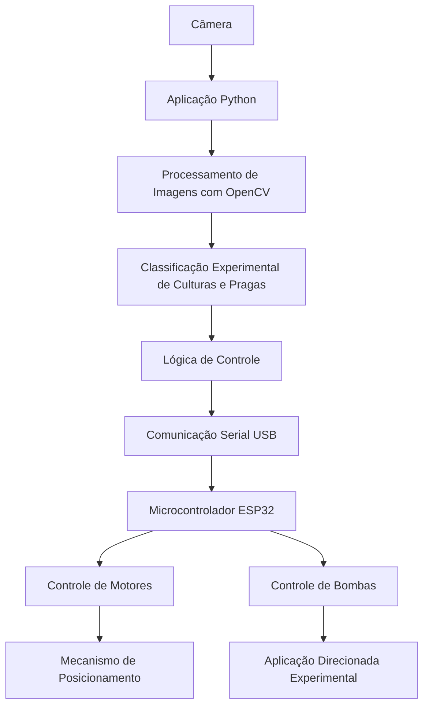

<div align="center">

# 🌱 LEAF

### Low-Cost Ecological AgroCare Framework

**Tornando a agricultura de precisão mais acessível, sustentável e inteligente.**

Um projeto de pesquisa estudantil que combina **visão computacional, sistemas embarcados, automação agrícola e proteção ecológica de culturas** para investigar alternativas acessíveis à agricultura moderna.

[](https://www.python.org/)
[](https://opencv.org/)
[](https://www.espressif.com/)
[](LICENSE)
[](#-status-do-projeto)

**[🌐 Site Oficial](https://henriquebrtocosta.github.io/leaf-cmjf/)** · **[📁 Arquivos do Projeto](docs/pesquisa/)** · **[💬 Contribuir](https://github.com/henriquebrtocosta/leaf-cmjf/issues)**

**🌍 Idiomas:** [English](README.en.md) | Português (Brasil)

</div>

---

## 📖 Visão Geral

O **LEAF (Low-Cost Ecological AgroCare Framework)** é um projeto de pesquisa interdisciplinar voltado à investigação de tecnologias acessíveis para a agricultura sustentável e de precisão.

O projeto estuda como a visão computacional, os sistemas automatizados de pulverização e as formulações agrícolas de origem natural podem contribuir para uma proteção mais direcionada das culturas, especialmente em contextos nos quais o acesso a tecnologias agrícolas avançadas é limitado.

Ao integrar software, eletrônica e pesquisa agrícola, o LEAF busca desenvolver uma estrutura experimental que possa apoiar estudos futuros sobre a redução do uso desnecessário de insumos químicos, o aumento da precisão das aplicações e a democratização da automação agrícola.

> [!IMPORTANT]
> O LEAF é um **projeto acadêmico experimental**, e não um produto agrícola comercialmente validado. A precisão da identificação visual, a confiabilidade dos componentes eletrônicos, a eficácia das formulações e os benefícios ambientais ainda precisam ser avaliados experimentalmente antes de qualquer aplicação prática.

Para ter acesso aos nossos artigos e materiais científicos, envie um email para henriquebrtocosta@gmail.com ou lgcaovilla@gmail.com

## 🎯 Objetivos do Projeto

O desenvolvimento do LEAF é orientado por cinco objetivos principais:

- **Acessibilidade:** investigar alternativas de baixo custo utilizando hardware acessível e software de código aberto.
- **Automação:** estudar mecanismos controlados computacionalmente para aplicações agrícolas direcionadas.
- **Visão Computacional:** desenvolver técnicas de processamento de imagens capazes de identificar culturas e detectar indicadores visuais associados à possível presença de pragas.
- **Sustentabilidade:** pesquisar formulações agrícolas de origem natural e avaliar seu potencial na proteção de culturas.
- **Educação e Pesquisa:** estimular a experimentação interdisciplinar envolvendo programação, eletrônica, ciências ambientais e agricultura.

## ✨ Principais Funcionalidades

O protótipo e sua documentação técnica descrevem os seguintes componentes:

| Componente                   | Descrição                                                                                 |
| ---------------------------- | ----------------------------------------------------------------------------------------- |
| 📷 Visão Computacional       | Captura e processamento de imagens utilizando Python e OpenCV.                            |
| 🌿 Identificação de Culturas | Regras experimentais de classificação visual para determinadas culturas agrícolas.        |
| 🔍 Indicação de Pragas       | Detecção de padrões visuais potencialmente associados à presença de pragas.               |
| ⚙️ Controle Embarcado        | Arquitetura baseada em ESP32 para controle de motores e bombas de pulverização.           |
| 🔌 Comunicação Serial        | Comunicação entre a aplicação Python e o microcontrolador por meio de conexão USB serial. |
| 💧 Pulverização Direcionada  | Mecanismo experimental destinado à aplicação mais seletiva de soluções agrícolas.         |
| 🌱 Pesquisa Ecológica        | Investigação de ingredientes de origem natural para possíveis formulações agrícolas.      |
| 🌐 Site do Projeto           | Plataforma pública de apresentação dos objetivos e das atividades de pesquisa.            |

### Abordagem de Visão Computacional

A abordagem de processamento de imagens documentada utiliza principalmente **OpenCV, NumPy, segmentação baseada em cores e regras heurísticas de classificação**.

Entre as técnicas empregadas estão a análise de imagens no espaço de cores HSV e a identificação de regiões com características visuais específicas.

Embora a inteligência artificial faça parte das direções de pesquisa do projeto, a implementação documentada não deve ser confundida com um modelo de aprendizado de máquina treinado e validado.

A identificação de culturas e a detecção de possíveis pragas permanecem experimentais e não devem ser interpretadas como diagnósticos agronômicos confiáveis.

## 🏗️ Arquitetura do Sistema

O LEAF investiga uma arquitetura modular que conecta processamento de imagens e controle de hardware embarcado.



### Como Funciona

1. **Captura de Imagens:** uma câmera conectada registra imagens das plantas observadas.
2. **Processamento:** a aplicação Python analisa regiões selecionadas das imagens capturadas.
3. **Classificação Visual:** algoritmos experimentais identificam cores, formas e outras características visuais.
4. **Decisão de Controle:** o software determina a ação correspondente com base em sua lógica programada.
5. **Comunicação Serial:** comandos são transmitidos ao microcontrolador ESP32.
6. **Operação do Hardware:** o ESP32 coordena os movimentos dos motores e o acionamento das bombas conforme as instruções do firmware.

Esse fluxo representa a integração investigada pelo projeto. Sua confiabilidade e seu desempenho devem ser avaliados por meio de testes controlados.

## 🛠️ Tecnologias Utilizadas

### Software

| Tecnologia             | Finalidade                                               |
| ---------------------- | -------------------------------------------------------- |
| Python 3               | Aplicação principal e lógica de controle                 |
| OpenCV                 | Captura e processamento de imagens                       |
| NumPy                  | Operações numéricas e manipulação de matrizes de imagens |
| Matplotlib             | Visualização de dados e imagens                          |
| PySerial               | Comunicação serial com o ESP32                           |
| pyttsx3                | Funcionalidades de síntese de voz                        |
| keyboard               | Gerenciamento de entradas pelo teclado                   |
| HTML, CSS e JavaScript | Desenvolvimento do site público do projeto               |

### Hardware

A arquitetura experimental inclui:

- Microcontrolador ESP32
- Conexão USB serial
- Câmera ou webcam compatível
- Motor de passo e driver correspondente
- Chaves de fim de curso
- Bombas controladas eletricamente
- Componentes mecânicos de posicionamento e pulverização

Os detalhes de fiação, alimentação elétrica e configuração dos componentes devem ser verificados antes da operação do protótipo.

## Site e organização

Consulte o [guia de manutenção do site](docs/site.md) para executar, testar e manter o código. Os artigos, roteiros e materiais do protótipo estão em [pesquisa/](docs/pesquisa/).

## 🌱 Pesquisa em Proteção Ecológica de Culturas

Além dos componentes de automação, o LEAF investiga ingredientes de origem natural e suas possíveis aplicações na agricultura.

Entre os ingredientes abordados nos materiais de pesquisa do projeto estão:

- Neem
- Própolis
- Alho
- Cebola
- Pimenta-malagueta
- Óleo de cravo
- Sabão potássico

Essas substâncias são objetos de investigação científica, e não formulações validadas ou recomendações de aplicação.

Sua possível eficácia depende de fatores como composição, concentração, organismos-alvo, espécie cultivada, método de aplicação e condições ambientais.

**A origem natural de uma substância não garante sua segurança, eficácia ou compatibilidade ambiental.**

Antes de qualquer aplicação agrícola, as formulações devem ser avaliadas quanto à fitotoxicidade, à exposição humana, aos efeitos sobre organismos não alvo e ao cumprimento das normas aplicáveis.

## 📊 Status do Projeto

**Situação atual: Pesquisa e desenvolvimento experimental.**

O LEAF é uma iniciativa acadêmica em desenvolvimento. Seus componentes documentados fornecem uma base para experimentação, mas o sistema completo ainda não foi estabelecido como uma solução agrícola pronta para utilização em campo.

### Prioridades de Pesquisa e Desenvolvimento

- [ ] Desenvolver um conjunto de imagens reproduzível para experimentos de classificação.
- [ ] Avaliar a precisão da classificação em diferentes condições de iluminação e cultivo.
- [ ] Investigar modelos treinados de aprendizado de máquina e compará-los com métodos heurísticos.
- [ ] Documentar a fiação, a pinagem e a montagem mecânica do ESP32.
- [ ] Validar a confiabilidade da comunicação serial e do controle dos componentes.
- [ ] Implementar e documentar procedimentos de segurança operacional.
- [ ] Medir a precisão das aplicações e o consumo de líquidos.
- [ ] Avaliar formulações agrícolas por meio de protocolos experimentais adequados.
- [ ] Publicar resultados de testes reproduzíveis e documentação técnica.

A lista representa prioridades de desenvolvimento, não compromissos ou prazos confirmados.

## 🔬 Pesquisa e Validação

Um dos objetivos centrais do LEAF é fornecer uma base para experimentação científica mensurável.

As futuras avaliações devem considerar:

| Área de Pesquisa          | Avaliações Sugeridas                                                             |
| ------------------------- | -------------------------------------------------------------------------------- |
| Visão Computacional       | Acurácia, precisão, revocação e robustez diante de mudanças ambientais           |
| Identificação de Culturas | Desempenho com diferentes espécies e estágios de crescimento                     |
| Automação                 | Confiabilidade do controle, repetibilidade do posicionamento e tempo de resposta |
| Pulverização              | Consistência de aplicação, consumo de líquido e precisão de direcionamento       |
| Formulações Agrícolas     | Eficácia, fitotoxicidade e efeitos sobre organismos não alvo                     |
| Acessibilidade            | Custos dos componentes, necessidades de manutenção e reprodutibilidade           |

Nenhuma alegação quantitativa de desempenho deve ser considerada comprovada sem dados experimentais que a sustentem.

## 🤝 Como Contribuir

O LEAF está aberto a sugestões construtivas, relatos de problemas, melhorias na documentação e discussões relacionadas à pesquisa.

Se você deseja contribuir:

1. Explore o repositório e a documentação existente.
2. Abra uma [issue](https://github.com/henriquebrtocosta/leaf-cmjf/issues) descrevendo o problema ou a melhoria proposta.
3. Faça um fork do repositório e crie uma branch específica.
4. Implemente e documente suas alterações.
5. Envie um pull request explicando sua contribuição e os testes realizados.

Contribuições envolvendo controle de hardware ou aplicações agrícolas devem apresentar claramente os riscos associados e os requisitos de validação.

## 🧰 Desenvolvimento, testes e publicação

### Estrutura principal

```text
leaf-cmjf/
├── index.html
├── assets/
│   ├── css/styles.css
│   ├── js/main.js
│   └── images/
├── docs/
│   ├── formulacao.md
│   ├── site.md
│   └── pesquisa/
├── tests/assistant.test.cjs
├── package.json
├── package-lock.json
├── .editorconfig
├── .prettierrc.json
├── .prettierignore
├── .gitignore
├── .gitattributes
├── README.md
├── README.en.md
└── LICENSE
```

O site é estático: não precisa de compilação nem instalação para abrir. Abra `index.html` ou execute, na raiz do repositório:

```sh
python -m http.server 8765 --bind 127.0.0.1
```

Depois, acesse `http://127.0.0.1:8765`.

### Testes e formatação

Com Node.js instalado, execute os testes automatizados:

```sh
node --test tests/assistant.test.cjs
```

Para instalar as ferramentas de desenvolvimento e verificar ou aplicar a formatação:

```sh
npm ci
npm test
npm run format:check
npm run format
```

### Publicação e manutenção

A branch `main` reúne a versão consolidada. O GitHub Pages publica os arquivos estáticos da raiz; a origem pode ser conferida em **Settings → Pages → Build and deployment**.

Antes de excluir ou substituir uma branch, confirme que ela não é a fonte de publicação e que suas alterações já foram incorporadas à `main`. Ao mover documentos, atualize os links do site e da documentação.

Para relatar problemas ou sugerir melhorias, use as [issues do repositório](https://github.com/henriquebrtocosta/leaf-cmjf/issues). Consulte também o [guia de manutenção do site](docs/site.md) e a [documentação da formulação](docs/formulacao.md).

## 👥 Equipe do Projeto

O LEAF é desenvolvido como uma iniciativa interdisciplinar de pesquisa liderada por estudantes.

**Estudantes Pesquisadores e Desenvolvedores**

- **Henrique Barreto Costa**
- **Luiz Guilherme Caovilla**

**Professor Orientador**

- **Guilherme Marins Maciel**

## ⚖️ Uso Responsável

O LEAF é disponibilizado para fins educacionais, experimentais e de pesquisa.

Equipamentos agrícolas automatizados podem envolver riscos elétricos, mecânicos, químicos e ambientais. Os usuários são responsáveis por garantir procedimentos adequados de segurança, supervisão e conformidade legal.

O projeto não garante precisão na identificação de pragas, eficácia na proteção das culturas, redução do consumo de defensivos agrícolas ou adequação para utilização comercial.

## 📄 Licença

Este repositório é distribuído sob a **Licença MIT**.

Consulte o arquivo [LICENSE](LICENSE) para conhecer todos os termos da licença.

A licença de software não concede autorização regulatória para formulações agrícolas, aplicações de defensivos ou operação de equipamentos físicos.

## 🔗 Links Úteis

- 🌐 [Site Oficial do Projeto](https://henriquebrtocosta.github.io/leaf-cmjf/)
- 💻 [Repositório no GitHub](https://github.com/henriquebrtocosta/leaf-cmjf)
- 📁 [Materiais do Projeto](docs/pesquisa/)
- 🐛 [Issues e Sugestões](https://github.com/henriquebrtocosta/leaf-cmjf/issues)
- 🇺🇸 [English README](README.en.md)

---

<div align="center">

### 🌿 Tecnologia e pesquisa para um futuro agrícola mais sustentável.

**LEAF — Low-Cost Ecological AgroCare Framework**

_Explorando a inovação acessível por meio da ciência, engenharia e responsabilidade ambiental._

**[Voltar ao Início ↑](#-leaf)**

</div>
