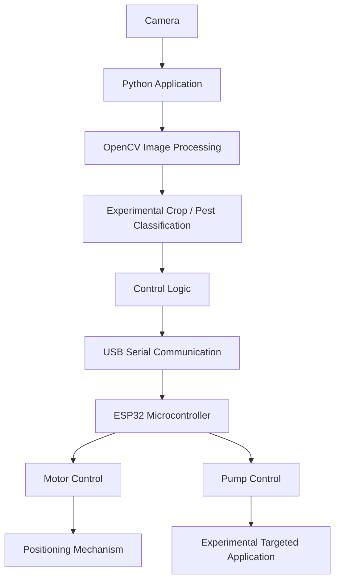

<div align="center">

# 🌱 LEAF

### Low-Cost Ecological AgroCare Framework

**Making precision agriculture more accessible, sustainable, and intelligent.**

A student-led research project combining **computer vision, embedded systems, agricultural automation, and ecological crop protection** to explore affordable alternatives for modern farming.

[](https://www.python.org/)
[](https://opencv.org/)
[](https://www.espressif.com/)
[](LICENSE)
[](#project-status)

**[🌐 Project Website](https://henriquebrtocosta.github.io/leaf-cmjf/)** · **[📁 Project Files](Files/)** · **[💬 Contribute](https://github.com/henriquebrtocosta/leaf-cmjf/issues)**

**🌍 Languages:** English | [Português (Brasil)](README.pt-BR.md)

</div>

---

## 📖 Overview

**LEAF (Low-Cost Ecological AgroCare Framework)** is an interdisciplinary research project focused on exploring affordable technologies for sustainable and precision agriculture.

The project investigates how computer vision, automated spraying systems, and naturally derived agricultural formulations could contribute to more targeted crop protection, particularly in contexts where access to advanced agricultural technologies may be limited.

By integrating software, electronics, and agricultural research, LEAF aims to develop an experimental framework that can support future studies on reducing unnecessary chemical inputs, improving application precision, and making agricultural automation more accessible.

> [!IMPORTANT]
> LEAF is an **experimental academic project**, not a commercially validated agricultural product. Detection accuracy, hardware reliability, formulation effectiveness, and environmental benefits require further testing before practical deployment.

## 🎯 Project Objectives

LEAF is guided by five main objectives:

- **Accessibility:** Explore low-cost hardware and open-source software as alternatives to expensive precision agriculture systems.
- **Automation:** Investigate computer-controlled mechanisms for targeted agricultural applications.
- **Computer Vision:** Develop image-processing techniques capable of identifying crops and detecting visual indicators associated with potential pests.
- **Sustainability:** Research naturally derived agricultural formulations and evaluate their potential role in crop protection.
- **Education and Research:** Encourage interdisciplinary experimentation involving programming, electronics, environmental sciences, and agriculture.

## ✨ Key Features

The prototype and its technical documentation describe the following components.

| Component | Description |
|---|---|
| 📷 Computer Vision | Camera-based image acquisition and processing using Python and OpenCV. |
| 🌿 Crop Identification | Experimental visual classification rules for selected crops. |
| 🔍 Pest Indication | Detection of visual patterns that may be associated with pest presence. |
| ⚙️ Embedded Control | ESP32-based control architecture for motors and spraying pumps. |
| 🔌 Serial Communication | Communication between the Python application and the microcontroller over USB serial. |
| 💧 Targeted Spraying | Experimental mechanism intended to enable more selective application. |
| 🌱 Ecological Research | Investigation of naturally derived ingredients for agricultural formulations. |
| 🌐 Project Website | Public website presenting the project and its research objectives. |

### Computer Vision Approach

The documented image-processing approach relies primarily on **OpenCV, NumPy, color-based segmentation, and heuristic classification rules**.

It includes techniques such as HSV color-space analysis and detection of image regions with specific visual characteristics.

The project's research direction includes artificial intelligence, but the documented implementation should not be mistaken for a validated, trained machine-learning model.

Crop classification and potential pest detection remain experimental and should not be interpreted as reliable agronomic diagnoses.

## 🏗️ System Architecture

LEAF explores a modular architecture connecting computer vision to embedded hardware.



### How It Works

1. **Image Acquisition:** A connected camera captures images of the observed plants.
2. **Image Processing:** The Python application processes selected regions of the captured frames.
3. **Visual Classification:** Experimental algorithms analyze colors, shapes, and other image characteristics.
4. **Control Decision:** The software determines the corresponding control action based on its programmed logic.
5. **Serial Communication:** Commands are transmitted to the ESP32 microcontroller.
6. **Hardware Operation:** The ESP32 coordinates motor movement and pump activation according to its firmware.

This workflow describes the project's intended integration. Its reliability and performance must be assessed through controlled testing.

## 🛠️ Technology Stack

### Software

| Technology | Purpose |
|---|---|
| Python 3 | Main application and control logic |
| OpenCV | Image acquisition and processing |
| NumPy | Numerical operations and image-array processing |
| Matplotlib | Data and image visualization |
| PySerial | Serial communication with ESP32 |
| pyttsx3 | Text-to-speech functionality |
| keyboard | Keyboard input handling |
| HTML, CSS, JavaScript | Public project website |

### Hardware

The experimental hardware architecture includes:

- ESP32 microcontroller
- USB serial connection
- Camera or compatible webcam
- Stepper motor and corresponding driver
- Limit switches
- Electrically controlled pumps
- Mechanical positioning and spraying components

Specific wiring, power requirements, and hardware configurations must be verified before operating the prototype.

## 📂 Repository Structure

The public repository contains the project's website, documentation, license, and supporting materials.

```text
leaf-cmjf/
├── Files/              # Supporting project materials
├── index.html          # Public project website
├── README.md           # Main documentation (English)
├── README.pt-BR.md     # Portuguese documentation
├── LICENSE             # MIT License
└── .gitignore
```

The technical documentation also references the following prototype files:

| File | Purpose |
|---|---|
| `leaf.py` | Main Python application |
| `funcao_identific.py` | Image analysis and experimental classification |
| `executar.bat` | Windows application launcher |
| `firmware_usb.ino` | Main ESP32 firmware sketch |
| `controle_motor.ino` | Motor control |
| `comunicacao_serial.ino` | Serial communication handling |
| `controle_bombas.ino` | Pump control |

> [!NOTE]
> These prototype files are documented as project components, but their exact locations within the current public repository have not been fully verified. Locate the corresponding files before following the execution instructions below.

## 🚀 Getting Started

### Prerequisites

For the Python prototype, the documented requirements include:

- Python 3
- A compatible camera
- Windows for the provided `.bat` launcher
- An ESP32 and compatible hardware for physical integration
- Arduino IDE for uploading and configuring the firmware

The project website can be viewed independently of the physical prototype.

### 1. Clone the Repository

```bash
git clone https://github.com/henriquebrtocosta/leaf-cmjf.git
cd leaf-cmjf
```

### 2. Locate the Application Files

Find the directory containing the main Python application (`leaf.py`) and its associated modules.

The following commands should be executed from that directory.

### 3. Create a Virtual Environment

On Windows:

```powershell
python -m venv .venv
```

### 4. Install Dependencies

Install the Python packages used by the documented prototype:

```powershell
.venv\Scripts\python.exe -m pip install opencv-python numpy keyboard pyserial pyttsx3 matplotlib
```

These dependencies are not currently presented as a verified, version-pinned installation environment.

### 5. Configure the Application

Before running the application, check its camera and serial communication settings.

The existing documentation references the following configuration:

| Setting | Documented Value | Description |
|---|---|---|
| Serial port | `COM8` | Port assigned to the ESP32 |
| Baud rate | `9600` | Serial communication speed |
| Camera index | `1` | Camera device selected by OpenCV |

These settings may need to be changed depending on your computer and connected devices.

### 6. Run the Python Application

From the directory containing `leaf.py`:

```powershell
.venv\Scripts\python.exe leaf.py
```

If `executar.bat` is available and its paths match your local directory structure, it may also be used as a Windows launcher.

### 7. ESP32 Firmware

For hardware integration:

1. Locate the `firmware_usb` firmware directory.
2. Open `firmware_usb.ino` using the Arduino IDE.
3. Keep the related `.ino` files in the same sketch directory.
4. Select the correct ESP32 board and communication port.
5. Verify the firmware configuration and electrical connections.
6. Test the system under controlled conditions, initially without agricultural formulations.

> [!CAUTION]
> Do not connect motors or pumps directly to microcontroller pins without appropriate drivers and electrical protection. Verify power requirements, wiring, and emergency shutdown procedures before operating physical equipment.

## 🌱 Ecological Crop Protection Research

Alongside its automation components, LEAF investigates naturally derived ingredients and their potential applications in agriculture.

The project's research materials discuss ingredients such as:

- Neem
- Propolis
- Garlic
- Onion
- Chili pepper
- Clove oil
- Potassium soap

These substances are considered research subjects rather than validated formulations or application recommendations.

Their possible effectiveness depends on factors including composition, concentration, target organisms, crop species, application methods, and environmental conditions.

**Natural origin does not guarantee safety, effectiveness, or environmental compatibility.**

Before any agricultural application, formulations must be evaluated for crop phytotoxicity, human exposure, effects on non-target organisms, and compliance with applicable regulations.

## 📊 Project Status

**Current status: Research and experimental development.**

LEAF is an ongoing academic initiative. Its documented components provide a basis for experimentation, but the complete system has not been established as a field-ready agricultural solution.

### Research and Development Priorities

- [ ] Develop a reproducible image dataset for classification experiments.
- [ ] Evaluate classification accuracy under different lighting and crop conditions.
- [ ] Investigate trained machine-learning models and compare them with heuristic methods.
- [ ] Document ESP32 wiring, pin assignments, and mechanical assembly.
- [ ] Validate serial communication and hardware control reliability.
- [ ] Implement and document operational safety procedures.
- [ ] Measure application accuracy and liquid consumption.
- [ ] Evaluate agricultural formulations through appropriate experimental protocols.
- [ ] Publish reproducible test results and technical documentation.

The checklist represents development priorities, not confirmed commitments or deadlines.

## 🔬 Research and Validation

A central goal of LEAF is to provide a foundation for measurable experimentation.

Future evaluations should consider:

| Research Area | Suggested Evaluation |
|---|---|
| Computer Vision | Accuracy, precision, recall, and robustness to environmental changes |
| Crop Identification | Performance across different plant species and growth stages |
| Automation | Control reliability, positioning repeatability, and response time |
| Spraying | Application consistency, liquid consumption, and targeting accuracy |
| Agricultural Formulations | Efficacy, phytotoxicity, and effects on non-target organisms |
| Accessibility | Component costs, maintenance requirements, and reproducibility |

No quantitative performance claims should be interpreted as established without supporting experimental data.

## 🤝 Contributing

LEAF welcomes constructive suggestions, bug reports, documentation improvements, and research-oriented discussions.

If you would like to contribute:

1. Explore the repository and the existing documentation.
2. Open an [issue](https://github.com/henriquebrtocosta/leaf-cmjf/issues) to describe a problem or improvement.
3. Fork the repository and create a dedicated branch.
4. Implement and document your changes.
5. Submit a pull request explaining your contribution and any tests performed.

Contributions involving hardware control or agricultural applications should clearly describe associated risks and validation requirements.

## 👥 Project Team

LEAF is developed as a student-led interdisciplinary research initiative.

**Student Researchers and Developers**

- **Henrique Barreto Costa**
- **Luiz Guilherme Caovilla**

**Faculty Advisor**

- **Guilherme Marins Maciel**

## ⚖️ Responsible Use

LEAF is provided for educational, experimental, and research purposes.

Automated agricultural equipment may involve electrical, mechanical, chemical, and environmental hazards. Users are responsible for ensuring appropriate safety procedures, supervision, and legal compliance.

The project does not guarantee pest identification accuracy, crop protection effectiveness, reduced pesticide consumption, or suitability for commercial deployment.

## 📄 License

This repository is distributed under the **MIT License**.

See the [LICENSE](LICENSE) file for the complete license terms.

The software license does not grant regulatory approval for agricultural formulations, pesticide applications, or physical equipment operation.

## 🔗 Useful Links

- 🌐 [Official Project Website](https://henriquebrtocosta.github.io/leaf-cmjf/)
- 💻 [GitHub Repository](https://github.com/henriquebrtocosta/leaf-cmjf)
- 📁 [Project Materials](Files/)
- 🐛 [Issues and Suggestions](https://github.com/henriquebrtocosta/leaf-cmjf/issues)
- 🇧🇷 [Documentação em Português](README.pt-BR.md)

---

<div align="center">

### 🌿 Technology and research for a more sustainable agricultural future.

**LEAF — Low-Cost Ecological AgroCare Framework**

*Exploring accessible innovation through science, engineering, and environmental responsibility.*

**[Back to Top ↑](#-leaf)**

</div>
